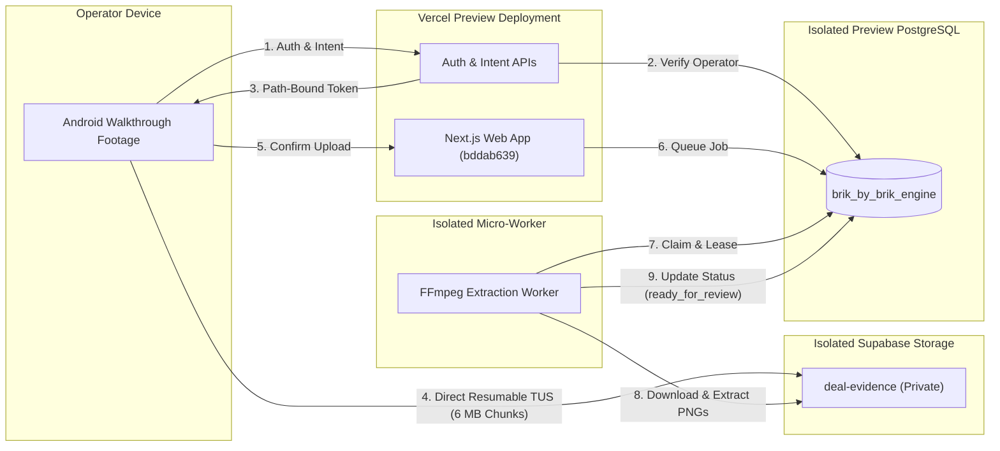

# BRIK BY BRIK — INFRASTRUCTURE ESTIMATES & OWNER DECISIONS
## Preview Environment Specification and Decision Sheet

**Document Reference:** `docs/option2/preview-readiness/PREVIEW_INFRASTRUCTURE_COSTS_AND_OWNER_DECISIONS.md`  
**Target Decision Date:** November 6, 2026 Controlled Preview  
**Owner:** James Lake  
**Application Baseline:** `bddab6390799328b18068e48922963f370c8edbd`  
**Status:** READ-ONLY ESTIMATES & DECISION FORM — NO PROVISIONING PERFORMED  

---

## 1. Isolated Preview Infrastructure Specification

To validate the end-to-end Video-to-Evidence workflow with real operators while protecting Production data, an isolated Preview environment is proposed.

### Core Architecture Rules
1. **Zero Vercel Proxying:** Large video files never pass through Vercel serverless functions. Video chunks stream directly from the browser to private Supabase Storage via signed TUS tokens.
2. **Strict Storage Isolation:** Staging requires a dedicated bucket (`deal-evidence`) physically separate from any production files.
3. **Decoupled Worker Compute:** Server-side FFmpeg extraction runs in an independent container worker polling `video_jobs` via atomic database leases (`FOR UPDATE SKIP LOCKED`, 20-minute lease).
4. **Zero Paid AI:** No external paid vision APIs (OpenAI, Claude, AWS Rekognition) will be provisioned or invoked.

---

## 2. Preliminary Infrastructure Cost Estimates

> [!WARNING]
> **Plan Verification Disclaimer:** The figures below are **unverified preliminary engineering estimates** based on third-party published pricing. Actual charges depend entirely on James Lake's active Vercel, Supabase, and hosting account subscription tiers, existing utilization, and plan entitlements. No services have been provisioned and no spending has been committed.

| Component | Minimum Specification | Resource Tier | Preliminary Estimated Cost | Plan Dependency & Verification Required |
|---|---|---|:---:|---|
| **Vercel Preview Hosting** | Next.js App (`bddab639`) | Vercel Preview Deployment | **Subject to Vercel Plan** | Free if within existing Vercel Team plan preview deployment allowances; overage charges may apply if build limits exceeded. |
| **Preview Database** | PostgreSQL 15+ (with `brik_by_brik_engine`) | Supabase / Neon Isolated DB | **Subject to DB Plan** | Free tier projects exist on Supabase/Neon (500 MB limit), but active account entitlements must be verified by the owner. |
| **Private Video Storage** | Supabase Storage (`deal-evidence`) | Private Object Storage Bucket | **~£0.00 – £1.00 / mo (Estimate)** | Supabase free tier includes 1 GB storage. 20 pilot clips (~2–3 GB total) may incur small overage (~£0.021/GB/mo) depending on account plan. |
| **Bandwidth Egress** | Direct storage-to-browser | Direct Object Egress | **~£0.00 – £0.50 / mo (Estimate)** | 2 GB included free in Supabase free tier; overage ~£0.09/GB. Zero Vercel bandwidth egress consumed. |
| **Worker Compute** | 1 vCPU, 512 MB – 1 GB RAM (Railway / Render / Lightsail) | Dedicated Micro-Container | **~£4.00 – £8.00 / mo (Estimate)** | Third-party micro-container pricing for running FFmpeg worker. *(Can alternatively run locally during office hours at £0.00).* |
| **AI Vision Services** | External paid vision models | **STRICTLY DISABLED** | **£0.00** | Pure local/container FFmpeg extraction only. Zero API token consumption. |
| **TOTAL ESTIMATED MONTHLY COST** | | | **~£4.00 – £9.50 / mo (Preliminary Estimate)** | **Not a cost cap.** Subject to active provider plan limits and actual pilot upload volumes. |

---

## 3. Owner Decision Sheet: Five Outstanding Approvals

The following approvals have **already been granted** by James Lake and are **preserved without re-asking**:
- Approved in principle: Supabase Auth, 30-day temporary retention for worker scratch files, private storage of genuine frames, reuse of existing calculator/refurb/passport systems, controlled Preview target for November 6.
- Disabled by rule: External paid AI vision, automatic supplier pricing scraping.

The following **five specific decisions** remain outstanding and require explicit written action from James Lake:

### Decision 1: Production Deployment Protection Verification
- [ ] **Confirmed:** James Lake independently confirms that Vercel Deployment Protection is active and verified across all production hostnames (`brik-by-brik-engine-chi.vercel.app` and `brik-by-brik-engine.vercel.app`).
- **Critical Policy:** Production database connectivity remains disabled until this verification is completed. **Confirming Deployment Protection does NOT authorize deploying Security RC1.**

### Decision 2: Security-Only Production Release Authorization
- [ ] **Authorized:** James Lake provides separate, explicit written authorization to deploy Security RC1 (`58e3193`) to Production, apply database migration `20261021_task5a_operator_sessions.sql`, and activate the initial operator UUID allowlist (`OPERATOR_ALLOWED_SUBJECTS`).
- **Prerequisites:** Verified rollback path, database snapshot, and environment-specific security review must be completed prior to deployment.

### Decision 3: Inspection Checklist Wording Sign-Off
- [ ] **Approved:** James Lake reviews and approves the 58 independently rewritten inspection items (`C01`–`C45` and `V01`–`V13`) detailed in [`JAMES_CHECKLIST_C01_C45_V01_V13_APPROVAL.md`](file:///C:/Users/HP%20ELITE%20BOOK/Documents/Brik-by-Brik/.worktrees/task-11e-video-viewing/docs/option2/preview-readiness/JAMES_CHECKLIST_C01_C45_V01_V13_APPROVAL.md).
- **Impact:** Removes `(Unapproved Working Draft)` disclaimers and establishes the authoritative Brik property condition checklist.

### Decision 4: Preview Infrastructure & Preliminary Cost Approval
- [ ] **Approved:** James Lake approves provisioning an isolated Preview database, private storage bucket, and a dedicated micro-worker container (preliminarily estimated at ~£4.00–£9.50 / month, subject to verified plan entitlements) for the November 6 controlled Preview.
- **Impact:** Enables staging infrastructure for physical Android hardware and hosted TUS testing.

### Decision 5: Long-Term Video Evidence Retention Policy
- [ ] **Decision Required:** James Lake determines the long-term retention policy for original video evidence (Task 11B status: `RETAIN_PENDING_OWNER_POLICY`).
  - *Option A (Purge Raw Video):* Purge original walkthrough video footage from storage 30 days after upload, while retaining extracted lossless PNG frames (`is_reviewed_evidence = TRUE`) perpetually.
  - *Option B (Retain Bookmarked Video):* Retain original video footage perpetually for deals that reach offer stage or are bookmarked by an operator; purge raw video for archived/rejected deals after 30 days.
  - *Option C (Cold Archive Tier):* Move original video footage to cold archival storage (e.g. AWS S3 Glacier / Supabase cold storage) after 30 days for legal dispute auditability.
- **Note:** James's previously approved 30-day rule applies strictly to temporary worker scratch files and abandoned uploads.

---

## 4. Owner Sign-Off Signature

**James Lake:** ___________________________________  
**Date:** ________________________
