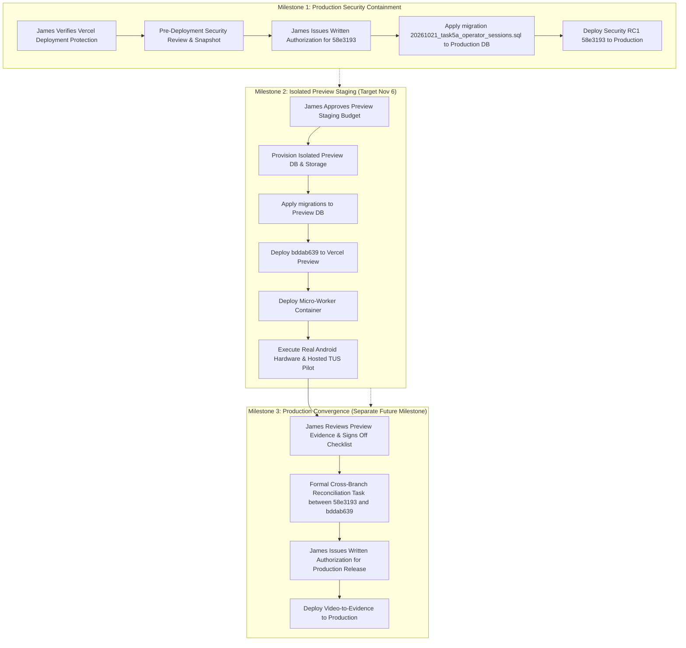

# BRIK BY BRIK — ARCHITECTURAL DEPENDENCY & RECONCILIATION PLAN
## Security Release Candidate (`58e3193`) and Video-to-Evidence Lineage (`bddab639`)

**Document Reference:** `docs/option2/preview-readiness/SECURITY_INTEGRATION_AND_PREVIEW_DEPENDENCIES.md`  
**Security Candidate:** `58e319376a7d387ee5350bd2f0f2d2a427e1fef6` (RC1 - Review Only)  
**Video-to-Evidence Baseline:** `bddab6390799328b18068e48922963f370c8edbd`  
**Production Baseline:** `6d0981b` (Legacy deployed build; database connectivity currently disabled)  
**Governance:** October 22, 2026 James Lake approvals (`b47e4a3`)  
**Mode:** READ-ONLY ARCHITECTURAL PLAN — NO MERGES, CHERRY-PICKS OR DEPLOYMENTS  

---

## 1. Executive Summary & Release Boundary Principles

This document establishes the relationship, dependencies, and release sequencing between the isolated **Security Release Candidate** (`58e3193`) and the **Video-to-Evidence Lineage** (`bddab639`).

### Non-Negotiable Release Principles
1. **No Automatic Authorization:** Verifying that Vercel Deployment Protection is active does **not** automatically grant permission to deploy Security RC1 (`58e3193`). A separate, explicit written authorization from James Lake is strictly required.
2. **Production Database Connectivity Disabled:** Production database connectivity must remain disabled (`28P01` credential failure status) until security verification is complete and authorized. Credentials must not be restored while an unauthenticated build is live.
3. **Pre-Deployment Prerequisites:** Before any production release, a verified rollback path, database snapshot, and an environment-specific security review (verifying Vercel environment variables, secrets, and headers) are mandatory.
4. **No Assumed Branch Equivalence:** Although Option 2 originated the operator authentication modules, `58e3193` was prepared on an isolated branch directly from `main` (`6d0981b`). **Exact line-by-line equivalence across all application boundaries cannot be claimed without an audited cross-branch diff.** Any unproven equivalence is marked unverified.
5. **No Automatic Fast-Forward Merge:** The Video-to-Evidence lineage (`bddab639`) must not be automatically merged into `main`. Controlled Preview acceptance is an isolated milestone, and any eventual production merge requires a separate, deliberate release cycle.
6. **No Guarantee of Zero Risk:** Deployment inherently entails operational risk (e.g. database migration locking, session invalidation across active operators, or legacy data shape variations). Zero risk or zero data loss must never be guaranteed.

---

## 2. Commit & Architectural Comparison

| Security Dimension | Security Candidate `58e3193` (RC1) | Video-to-Evidence `bddab639` (Option 2) | Technical Equivalence Status |
|---|---|---|---|
| **Parent Baseline** | Derived from `main` (`6d0981b`) | Derived from clean Option 2 candidate `92d2066` | **Divergent Lineages.** Branches share common history but diverge substantially in scope. |
| **Session Model** | `lib/viewing-assessment/auth/operator-session.ts` | `lib/viewing-assessment/auth/operator-session.ts` | **Code-Level Similarity.** Both use `__Host-brik_session`, HMAC signing, and Supabase JWT verification. Full equivalence requires a formal diff audit before any merge. |
| **Session Database** | `brik_by_brik_engine.operator_sessions` table | `brik_by_brik_engine.operator_sessions` table | **Functionally Equivalent.** Schema definition matches in local QA migrations. |
| **Protected Endpoints** | Protects 9 core Saved Deals routes | Protects 25 routes (Saved Deals, Viewing Assessments, and Video APIs) | **Different Coverage.** `bddab639` wraps 16 additional viewing/video routes with `authorize()`. |
| **Server-Derived Governance** | Rejects browser-supplied `governance_state` on `POST /api/saved-deals` | Rejects browser-supplied `governance_state` on `POST /api/saved-deals` | **Functionally Equivalent in Local QA.** Both enforce server-side engine derivation. |
| **Diagnostic Redaction** | Strips stack traces on 500 errors; outputs `traceId` | Strips stack traces on 500 errors; outputs `traceId` | **Functionally Equivalent in Local QA.** |
| **Dev Pages Lock** | 4 fixture routes return 404 outside `next dev` | 4 fixture routes return 404 outside `next dev` | **Functionally Equivalent in Local QA.** |
| **Video & Extraction** | **Completely Omitted** (0 video files) | Includes `video_jobs`, `video_frames`, TUS uploader, FFmpeg worker | **Clean Feature Boundary.** Video functionality exists solely in `bddab639`. |

---

## 3. Strict Phased Release Sequencing

### Milestone 1: Production Security Containment (`58e3193`)
1. **Verification of Deployment Protection:** James Lake independently verifies that Vercel Deployment Protection (password or SSO) is active across all production hostnames (`brik-by-brik-engine-chi.vercel.app` and `brik-by-brik-engine.vercel.app`).
2. **Pre-Deployment Security Review:** Verify production environment variables (`OPERATOR_AUTH_MODE=supabase-jwt`, `OPERATOR_ALLOWED_SUBJECTS`, etc.) and ensure no localhost or simulator variables exist.
3. **Database Snapshot:** Perform a full snapshot of the production database.
4. **Separate Owner Authorization:** James Lake provides explicit written authorization to deploy `58e3193`.
5. **Execution:** Apply migration `20261021_task5a_operator_sessions.sql` and promote commit `58e3193` to Production.
6. **Rollback Precedence:** If deployment fails, redeploy previous guarded build or empty `OPERATOR_ALLOWED_SUBJECTS`. Keep Deployment Protection enabled throughout.

### Milestone 2: Controlled Preview Staging (`bddab639`) — November 6 Target
1. **Infrastructure Isolation:** Provision a completely isolated non-production Supabase instance (database + private storage bucket `deal-evidence`) and a dedicated micro-worker container.
2. **Preview Migrations:** Apply `operator_sessions` and `video_evidence_schema` migrations to the Preview database.
3. **Preview Deployment:** Deploy `bddab639` to Vercel Preview with preview-scoped environment variables.
4. **Field Acceptance:** Execute real Android hardware testing (camera capture + upload over mobile networks) and hosted Supabase TUS chunking with authorized operators.

### Milestone 3: Production Convergence & Release (Future Milestone)
- Merging `bddab639` into `main` will **not** be executed automatically.
- Requires:
  1. Successful completion of Milestone 1 and Milestone 2.
  2. Formal written sign-off of the 58 checklist items by James Lake.
  3. A dedicated cross-branch reconciliation task auditing diffs between `58e3193` and `bddab639`.
  4. Separate written authorization from James Lake for Production deployment.

---

## 4. Operational Risk & Rollback Considerations

- **Database Locking Risk:** Applying migrations against production tables carries minor lock contention risks; migrations must use `--single-transaction -v ON_ERROR_STOP=1`.
- **Session Disruption:** Deploying `58e3193` will invalidate any unauthenticated access to Saved Deals immediately. All operators must sign in.
- **Data Shape Drift:** Saved deals created prior to server-derived governance enforcement may contain browser-supplied fields. A decision on whether to re-derive historical deals (Decision D6 in RC1 release gate) remains open for James Lake.
- **Rollback Guarantee Limitation:** While rollback procedures are verified locally, in a cloud environment network or configuration anomalies can occur. Deployment Protection is the primary fail-safe.
